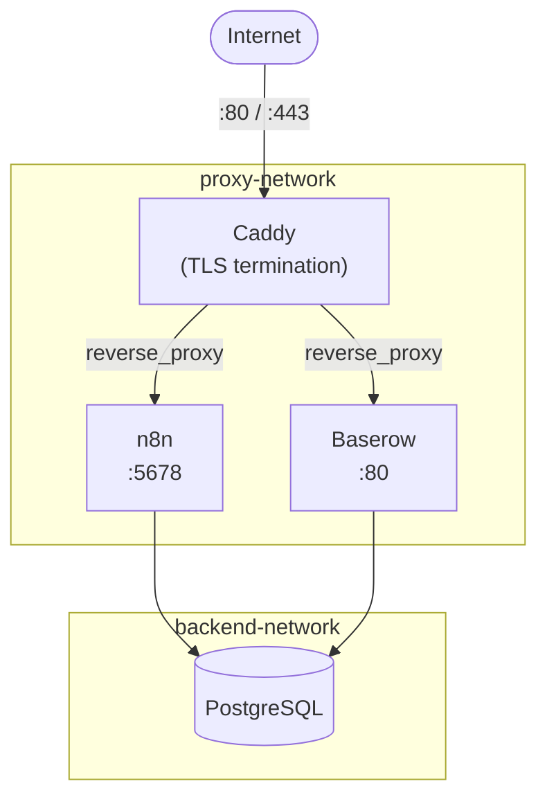

# Self-Hosted Automation Stack

[](LICENSE)
[](https://github.com/whybothercoding/self-hosted-automation-stack/actions/workflows/validate.yml)
[](https://github.com/whybothercoding/self-hosted-automation-stack/actions/workflows/security.yml)
[](https://github.com/whybothercoding/self-hosted-automation-stack/actions/workflows/backup-drill.yml)

A production-ready Docker Compose stack running **n8n**, **Baserow**, and **PostgreSQL** behind **Caddy** with automatic HTTPS. Clone, configure, and deploy a self-hosted automation suite on any VPS in minutes — no manual SSL certificate management, no external dependencies.

Every push boots the stack for real and checks the health endpoints (not just YAML syntax), the four pinned images are scanned weekly for CVEs, and the backup/restore path is proven weekly by actually destroying a volume, restoring it, and verifying the data survived. See [Security & Reliability](#security--reliability) below.

## Architecture



Caddy terminates TLS and proxies to n8n and Baserow over `proxy-network`. Neither Caddy nor the internet can reach PostgreSQL directly — it is only reachable from n8n and Baserow via `backend-network`. See [ADR-0003](docs/adr/0003-two-network-topology.md) for the reasoning.

## Services

| Service    | Image                            | Purpose                            | Default URL                      |
|------------|-----------------------------------|-------------------------------------|-----------------------------------|
| n8n        | `n8nio/n8n:2.44.4`                | Workflow automation                 | `https://n8n.yourdomain.com`     |
| Baserow    | `baserow/baserow:2.4.1`           | No-code database / spreadsheet UI   | `https://baserow.yourdomain.com` |
| PostgreSQL | `postgres:15.19-alpine3.24`       | Shared database backend             | Internal only                    |
| Caddy      | `caddy:2.11.7-alpine`             | Reverse proxy + automatic TLS       | Handles 80/443                   |

All four are version-pinned rather than `:latest` — [Dependabot](.github/dependabot.yml) opens a PR when a new release lands, so upgrades are reviewed, not silent. See [Updating Services](docs/updating-services.md).

## Prerequisites

- A VPS running Ubuntu 20.04 or later
- [Docker](https://docs.docker.com/engine/install/) and [Docker Compose v2](https://docs.docker.com/compose/install/) installed
- A domain name with DNS A records pointing to your server's public IP
- Ports 80 and 443 open in your firewall

## Quick Start

```bash
git clone https://github.com/whybothercoding/self-hosted-automation-stack.git
cd self-hosted-automation-stack
bash scripts/setup.sh
```

The setup script prompts for your domain, email, and passwords, writes `.env`, pulls images, and starts the stack. Caddy automatically issues Let's Encrypt certificates for both subdomains.

## Usage

### First Run

Once the stack is up, open your browser:

- **n8n:** `https://n8n.yourdomain.com` — create your admin account, then start building workflows
- **Baserow:** `https://baserow.yourdomain.com` — create your admin account, then create databases and tables

SSL certificates are issued within 1–2 minutes of first start. If your browser shows a certificate warning, wait a moment and refresh.

### Daily Management

```bash
make up         # Start the stack
make down       # Stop and remove containers
make restart    # Restart all services
make logs       # Follow logs for all services
make dev        # Start in dev mode (direct ports, no Caddy)
make test       # Boot the dev stack and verify both health endpoints respond
```

Or with Docker Compose directly:

```bash
docker compose ps
docker compose logs n8n --follow
docker compose restart n8n
```

### Backup & Restore

```bash
make backup         # Stops the stack, snapshots all volumes to ./backups/, restarts
make restore TIMESTAMP=20260823_140000   # Restore from a specific backup
make backup-test    # Full backup -> destroy -> restore -> verify drill (needs a running stack)
```

The same drill `make backup-test` runs locally runs weekly in CI — see [Backup & Restore](docs/backup-and-restore.md).

### Update

```bash
make update
# or: bash scripts/update.sh
```

Pulls latest images and redeploys. Always run a backup first.

## Development Mode

Run locally without Caddy — services are exposed on direct ports:

```bash
make dev
# or: docker compose -f docker-compose.yml -f docker-compose.dev.yml up
```

- n8n: [http://localhost:5678](http://localhost:5678)
- Baserow: [http://localhost:8080](http://localhost:8080)

## Security & Reliability

- **Network isolation** — `proxy-network` (Caddy + apps) and `backend-network` (apps + Postgres) are separate bridge networks; Postgres is unreachable from Caddy or the internet.
- **Container hardening** — every service runs with `no-new-privileges`; Caddy, n8n, and Postgres run with all Linux capabilities dropped except the specific ones each needs (`NET_BIND_SERVICE` for Caddy's privileged ports, five ownership-related caps for Postgres's first-init step). Baserow is intentionally not capability-dropped yet — its all-in-one process supervisor's root requirements aren't confirmed safe to guess at.
- **Resource limits & log rotation** — every service has a memory ceiling and capped, rotated JSON logs, so a runaway execution or import can't take down the whole VPS or fill the disk.
- **HSTS + standard security headers** on both Caddy virtual hosts.
- **Pinned images, tracked by Dependabot** — no `:latest` tags; version bumps arrive as reviewable PRs.
- **Weekly Trivy scan** of all four pinned images for known CVEs, results in the repo's Security tab.
- **CI actually boots the stack** — `validate.yml`'s smoke-test job runs the real dev stack and checks both health endpoints externally, not just `docker compose config`.
- **Backup/restore is proven, not just documented** — the weekly Backup Drill workflow writes a marker row, backs up, destroys the volume, restores from the tarball, and fails if the data isn't back.
- **Third-party GitHub Actions pinned by commit SHA**, not by tag — a direct response to the `aquasecurity/trivy-action` supply-chain compromise (March 2026), where 75 of 76 version tags were force-pushed with malware. Tags are mutable; SHAs aren't.

See [docs/adr/](docs/adr/) for the reasoning behind the bigger architectural choices.

## Environment Variables

| Variable             | Description                                           | Example                       |
|----------------------|-------------------------------------------------------|-------------------------------|
| `DOMAIN`             | Root domain                                           | `example.com`                 |
| `N8N_SUBDOMAIN`      | Subdomain for n8n                                     | `n8n`                         |
| `BASEROW_SUBDOMAIN`  | Subdomain for Baserow                                 | `baserow`                     |
| `POSTGRES_USER`      | PostgreSQL superuser name                             | `automation`                  |
| `POSTGRES_PASSWORD`  | PostgreSQL password                                   | *(strong random string)*      |
| `POSTGRES_DB`        | Default DB created at init                            | `automation`                  |
| `N8N_DB_NAME`        | Database name for n8n                                 | `n8n`                         |
| `BASEROW_DB_NAME`    | Database name for Baserow                             | `baserow`                     |
| `N8N_ENCRYPTION_KEY` | Encrypts n8n credentials — never change after set     | *(openssl rand -hex 32)*      |
| `BASEROW_SECRET_KEY` | Django secret key for Baserow                         | *(openssl rand -hex 32)*      |
| `GENERIC_TIMEZONE`   | Timezone for n8n scheduling                           | `Europe/Athens`               |
| `LETSENCRYPT_EMAIL`  | Email for Let's Encrypt registration                  | `you@example.com`             |
| `N8N_EMAIL_MODE`     | Email sending mode: `smtp` or empty                   | `smtp`                        |
| `N8N_SMTP_HOST`      | SMTP server hostname                                  | `smtp.example.com`            |
| `N8N_SMTP_PORT`      | SMTP port                                             | `587`                         |
| `N8N_SMTP_USER`      | SMTP username                                         | `user@example.com`            |
| `N8N_SMTP_PASS`      | SMTP password                                         | *(your smtp password)*        |
| `WEBHOOK_URL`        | Public URL for n8n webhooks                           | `https://n8n.example.com`     |

All variables are documented with comments in [`.env.example`](.env.example).

## Scripts

| Script                     | Description                                                          |
|-----------------------------|----------------------------------------------------------------------|
| `scripts/setup.sh`         | Interactive first-run: writes `.env`, pulls images, starts stack     |
| `scripts/backup.sh`        | Stops stack, snapshots all volumes to `backups/`, restarts stack     |
| `scripts/restore.sh`       | Restores all volumes from a timestamped backup                       |
| `scripts/backup-drill.sh`  | Full backup → destroy → restore → verify cycle (local or CI)         |
| `scripts/wait-for-healthy.sh` | Polls services until Docker reports them healthy; tolerates transient blips instead of failing on the first one |
| `scripts/update.sh`        | Pulls latest images, redeploys with `--remove-orphans`, prunes old   |

## Documentation

- [Initial Setup Guide](docs/initial-setup.md) — Full walkthrough from fresh VPS to running stack
- [SSL Configuration](docs/ssl-configuration.md) — How TLS works and troubleshooting
- [Backup & Restore](docs/backup-and-restore.md) — Backup volumes and restore procedures
- [Updating Services](docs/updating-services.md) — Safely updating n8n, Baserow, and Postgres
- [Troubleshooting](docs/troubleshooting.md) — Common issues and solutions
- [Architecture Decision Records](docs/adr/) — Why Caddy, why a shared Postgres instance, why two networks

## License

MIT — see [LICENSE](LICENSE)
